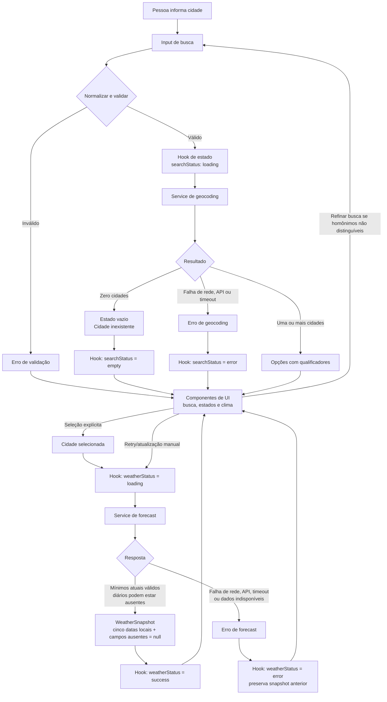

# Plano Técnico — Weather App

Este plano deriva da especificação em [`specs/weather-app-spec.md`](../specs/weather-app-spec.md). A spec é a fonte da verdade para o comportamento; este documento define a arquitetura, as decisões técnicas e os contratos necessários para implementá-lo, sem antecipar o código final.

## Architecture

Aplicação web client-side, sem autenticação, backend de produto ou persistência. A UI delega validação e coordenação ao hook de consulta; um serviço concentra a comunicação com Open-Meteo e converte as respostas externas em tipos internos. Componentes de apresentação recebem dados já normalizados e não conhecem o formato da API.

```text
Pessoa
  └─ UI React (busca, seleção de localidade, clima, unidade e estados)
       └─ estado local da aplicação (consulta + unidade)
            └─ hook de clima (validação, fluxo e timeout)
                 └─ serviço meteorológico
                      ├─ Open-Meteo Geocoding API
                      └─ Open-Meteo Forecast API
```

Decisões:

- Buscar somente após envio explícito; carregar o clima somente após seleção explícita de um resultado (FR-01, FR-02, FR-07).
- Atualizar somente por ação explícita. Não implementar polling, cache persistente, service worker ou funcionamento offline (FR-07; Out of Scope).
- Manter os dados meteorológicos em memória durante a sessão. Em falha, preservar o último resultado válido, sempre associado à sua própria cidade e horário, sem apresentá-lo como resultado da consulta malsucedida (FR-07, RNF-06).
- Separar a apresentação em componentes pequenos, mas manter coordenação e estado em um hook local, sem introduzir estado global ou biblioteca de data fetching.

## Tech Stack

| Tecnologia | Uso e justificativa |
|---|---|
| TypeScript strict | Contratos explícitos para domínio e respostas externas, reduzindo erros de mapeamento. |
| React + Vite | UI web responsiva e shell carregável sem serviço de produto no servidor. |
| Tailwind CSS | Estilização responsiva com tema dark glassmorphism, conforme as instruções do projeto. |
| Vitest + Testing Library | Testes unitários e de componentes dos contratos e estados observáveis da UI. |
| Playwright | Testes dos fluxos completos e dos viewports/navegadores definidos na spec. |
| Biome | Lint e formatação conforme a convenção do projeto. |
| Open-Meteo | Geocodificação global e previsão sem API key, conforme aprovação registrada na spec. |

Temperaturas serão solicitadas à API em Celsius e convertidas apenas para apresentação. O serviço solicitará vento em km/h; precipitação/probabilidade será tratada como porcentagem. Isso mantém o modelo interno independente da unidade escolhida pela pessoa (FR-05, FR-06, RNF-10).

## Project Structure

Estrutura proposta, compatível com as convenções existentes:

```text
src/
  components/
    SearchBar.tsx           # Entrada, envio e erros de validação
    CityResults.tsx         # Opções geográficas e seleção explícita
    CurrentWeather.tsx      # Condições atuais e atualização
    ForecastList.tsx        # Lista dos cinco dias
    ForecastCard.tsx        # Dados de um dia
    UnitToggle.tsx          # Controle Celsius/Fahrenheit
    states/
      LoadingState.tsx      # Estado de carregamento
      ErrorState.tsx        # Falha e nova tentativa manual
      EmptyState.tsx        # Estado inicial/sem resultados
  hooks/
    useWeather.ts           # Estado e coordenação das consultas
  services/
    weatherService.ts       # Open-Meteo, timeout e mapeamento de resposta
  types/
    weather.ts              # Tipos de domínio e contratos do serviço
  lib/
    search.ts               # Normalização/validação da entrada
    temperature.ts          # Conversão e arredondamento
    weather.ts              # Códigos meteorológicos e direção do vento
  App.tsx                   # Composição da tela e estado de unidade
```

Os nomes acima são contratos de organização, não exigência de criar cada arquivo como unidade isolada. Não criar módulo para uma abstração usada por um único ponto se isso aumentar a estrutura sem benefício.

## Data Model

Contratos conceituais em TypeScript. `null` representa campo ausente do provedor; ausência não deve ser substituída por estimativa ou valor derivado.

```ts
type TemperatureUnit = "celsius" | "fahrenheit";

interface City {
  id: number;
  name: string;
  latitude: number;
  longitude: number;
  country?: string;
  admin1?: string;
  timezone: string;
}

interface WeatherConditions {
  conditionCode: number | null;
  precipitationProbabilityPercent: number | null;
  windSpeedKmh: number | null;
  windDirectionDegrees: number | null;
}

interface CurrentWeather extends WeatherConditions {
  temperatureC: number | null;
  dailyMinimumC: number | null;
  dailyMaximumC: number | null;
}

interface ForecastDay extends WeatherConditions {
  date: string; // Data civil no fuso da cidade, formato ISO YYYY-MM-DD
  meanTemperatureC: number | null;
  minimumC: number | null;
  maximumC: number | null;
}

interface WeatherSnapshot {
  city: City;
  current: CurrentWeather;
  days: ForecastDay[]; // Cinco datas civis locais, mesmo sem valores diários
  fetchedAt: string; // Instante ISO de sucesso, formatado na UI no fuso da cidade
  sourceValidAt: string | null; // Instante de observação/validade, no fuso da cidade
}
```

Contratos de operação/estado:

```ts
type SearchError = "required" | "invalid" | "too-long";

type SearchStatus = "idle" | "loading" | "success" | "empty" | "error";
type WeatherStatus = "idle" | "loading" | "success" | "error";
type RequestError = "timeout" | "network" | "provider";

type WeatherError = RequestError | "unavailable";

interface WeatherService {
  searchCities(query: string, signal?: AbortSignal): Promise<City[]>;
  getWeather(city: City, signal?: AbortSignal): Promise<WeatherSnapshot>;
}

interface WeatherState {
  searchStatus: SearchStatus;
  searchResults: City[];
  searchRequestError: RequestError | null;
  selectedCity: City | null;
  weatherStatus: WeatherStatus;
  snapshot: WeatherSnapshot | null;
  weatherError: WeatherError | null;
  currentIsIncomplete: boolean;
  searchError: SearchError | null;
  unit: TemperatureUnit;
}
```

Regras do modelo:

- A busca é normalizada para Unicode NFC, com espaços externos removidos e sequências internas reduzidas antes da validação. Aceitar de 1 a 200 clusters de grafemas, somente letras e espaços; bloquear hífen, apóstrofo e demais caracteres antes da chamada (FR-01, CA-01).
- Cada `City` exibida é uma opção, não uma seleção implícita. Usar qualificadores geográficos disponíveis; se não distinguirem homônimos, não permitir consulta meteorológica até a pessoa refinar a busca (FR-02, CA-02).
- `days` deve conter hoje local e os quatro dias civis seguintes, calculados no fuso da cidade selecionada. Construir essas cinco datas mesmo que a resposta diária esteja vazia, curta ou não contenha algum dia; associar os valores retornados por data e preencher somente campos meteorológicos ausentes com `null`. A ausência de valores diários não torna a consulta `unavailable` nem autoriza inferências. Pares min/max inconsistentes são inválidos e ambos são tratados como ausentes.
- Os campos meteorológicos mínimos para considerar a consulta utilizável são temperatura atual e código/descrição da condição atual. Se faltar qualquer um, a consulta é `unavailable` e não deve ser apresentada como sucesso. As cinco datas da previsão são sempre construídas no fuso da cidade e não são requisito de disponibilidade; a falta de valores da previsão diária, probabilidade, vento ou extremos mantém a consulta disponível e deixa em branco apenas os campos ausentes.
- Datas e horários da UI são formatados em pt-BR usando o fuso da cidade selecionada. O horário da última atualização deve incluir uma indicação explícita do fuso (por exemplo, abreviação ou deslocamento UTC), além de usar o timezone da cidade e não o do dispositivo.
- A descrição é derivada do código meteorológico por mapeamento local em português. Direção do vento é convertida para um dos 16 setores cardeais (22,5° por setor, 0°/360° = norte).
- Converter valores de Celsius para a unidade ativa antes de arredondar ao inteiro mais próximo; empates arredondam para longe de zero. Unidade inicia em Celsius e vive somente na memória da sessão.

## Data Flow

1. A pessoa digita e envia a cidade. Normalizar NFC e espaços, contar grafemas e validar. Entrada vazia/inválida produz erro associado ao campo e não chama a API.
2. Para entrada válida, iniciar geocodificação e estado de carregamento. Resposta vazia produz “Cidade inexistente”; erro de rede/provedor e timeout são estados distintos.
3. Apresentar todos os resultados selecionáveis com nome e qualificadores geográficos retornados. Nenhuma seleção automática. Homônimos sem informação suficiente levam a solicitação de refinamento.
4. Ao selecionar uma cidade, consultar a previsão por suas coordenadas. O serviço mapeia resposta externa para `WeatherSnapshot`, constrói hoje e os quatro dias civis seguintes no fuso da cidade mesmo se faltarem valores diários, valida os dados mínimos das condições atuais e registra o instante de sucesso.
5. A UI apresenta o snapshot junto ao nome da cidade; formata datas da previsão e horários em pt-BR no fuso da cidade e indica explicitamente esse fuso no horário da última obtenção bem-sucedida. A idade é calculada pela observação/validade do provedor; acima de 24 horas, sinalizar como desatualizado.
6. Alternar a unidade apenas recalcula a apresentação das temperaturas existentes; não refaz a busca, não altera os dias e não preenche valores ausentes.
7. Uma ação explícita de atualizar repete a consulta da cidade selecionada. Se falhar, reter o snapshot anterior em memória, identificar a falha e conservar sua localidade, seu horário e o estado de desatualização.



Uma resposta tardia de uma consulta anterior não deve substituir o resultado da busca mais recente. O serviço deve aceitar `AbortSignal` ou a coordenação deve ignorar respostas de operações já substituídas.

## External APIs

### Geocodificação

**Endpoint:** `GET https://geocoding-api.open-meteo.com/v1/search`

Exemplo de URL:

```text
https://geocoding-api.open-meteo.com/v1/search?name=Lisboa&count=100&language=pt&format=json
```

Parâmetros usados:

| Parâmetro | Valor/uso |
|---|---|
| `name` | Busca normalizada segundo FR-01. |
| `count` | Solicitar até `100` resultados para reduzir o risco de omitir localidades homônimas. O limite do provedor não garante exaustividade; nunca selecionar automaticamente o primeiro. |
| `language` | `pt`, para localização dos nomes/qualificadores quando suportada. Nomes próprios retornados podem preservar a grafia do provedor. |
| `format` | `json`. |

Exemplo resumido de resposta:

```json
{
  "results": [
    {
      "id": 2267057,
      "name": "Lisboa",
      "latitude": 38.7167,
      "longitude": -9.1333,
      "country": "Portugal",
      "admin1": "Lisboa",
      "timezone": "Europe/Lisbon"
    }
  ],
  "generationtime_ms": 0.2
}
```

`results` pode estar ausente ou vazio quando não houver correspondências; isso representa “Cidade inexistente”, não erro do provedor. Os campos geográficos qualificadores podem variar ou estar ausentes.

**Mapeamento para `City`:**

| Open-Meteo | Modelo interno |
|---|---|
| `id` | `City.id` |
| `name` | `City.name` |
| `latitude`, `longitude` | `City.latitude`, `City.longitude` |
| `country` | `City.country` (propriedade omitida se ausente) |
| `admin1` | `City.admin1` (propriedade omitida se ausente) |
| `timezone` | `City.timezone`; se ausente, tratar como resposta insuficiente para cumprir datas/horários locais, não inventar o fuso. |

Exibir cada resultado como uma opção de seleção explícita. Solicitar até 100 resultados; esse limite reduz, mas não elimina, a possibilidade de haver outras localidades correspondentes. Usar país e subdivisão disponíveis para desambiguar; se os resultados retornados continuarem insuficientes para distinguir homônimos, pedir refinamento antes de consultar o forecast (FR-02).

### Previsão

**Endpoint:** `GET https://api.open-meteo.com/v1/forecast`

Exemplo de URL (quebras de linha apenas para leitura):

```text
https://api.open-meteo.com/v1/forecast
  ?latitude=38.7167
  &longitude=-9.1333
  &current=temperature_2m,weather_code,wind_speed_10m,wind_direction_10m
  &daily=temperature_2m_mean,temperature_2m_min,temperature_2m_max,weather_code,precipitation_probability_max,wind_speed_10m_max,wind_direction_10m_dominant
  &temperature_unit=celsius
  &wind_speed_unit=kmh
  &forecast_days=5
  &timezone=auto
```

Parâmetros usados:

| Parâmetro | Valor/uso |
|---|---|
| `latitude`, `longitude` | Coordenadas da `City` selecionada. |
| `current` | `temperature_2m`, `weather_code`, `wind_speed_10m`, `wind_direction_10m`. As unidades físicas vêm em `current_units`. |
| `daily` | `temperature_2m_mean`, `temperature_2m_min`, `temperature_2m_max`, `weather_code`, `precipitation_probability_max`, `wind_speed_10m_max`, `wind_direction_10m_dominant`. As unidades vêm em `daily_units`. |
| `timezone` | `auto`, para usar as datas e o fuso local da coordenada; o serviço também retorna o nome IANA resolvido em `timezone`. |
| `forecast_days` | `5`, solicitando hoje local e os quatro dias seguintes. A aplicação constrói essas cinco datas usando o timezone retornado mesmo se a resposta diária vier incompleta. |
| `temperature_unit` | `celsius`, base canônica do modelo; conversão para Fahrenheit ocorre na apresentação. |
| `wind_speed_unit` | `kmh`, conforme RNF-10. |

`precipitation_probability_max` e as temperaturas mínima/máxima são métricas diárias, não campos do objeto `current` da API. Para as condições atuais, associar esses dados ao registro diário da data local de hoje, se disponível. Apresentá-los como métricas do dia, sem descrevê-los como observações instantâneas; ausência desses dados não invalida a consulta.

Exemplo resumido de resposta (as séries diárias são paralelas: cada índice corresponde à data no mesmo índice de `daily.time`):

```json
{
  "latitude": 38.72,
  "longitude": -9.13,
  "timezone": "Europe/Lisbon",
  "timezone_abbreviation": "WEST",
  "utc_offset_seconds": 3600,
  "current_units": {
    "time": "iso8601",
    "temperature_2m": "°C",
    "weather_code": "wmo code",
    "wind_speed_10m": "km/h",
    "wind_direction_10m": "°"
  },
  "current": {
    "time": "2026-10-27T18:00",
    "interval": 900,
    "temperature_2m": 19.4,
    "weather_code": 2,
    "wind_speed_10m": 12.1,
    "wind_direction_10m": 270
  },
  "daily_units": {
    "time": "iso8601",
    "temperature_2m_mean": "°C",
    "temperature_2m_min": "°C",
    "temperature_2m_max": "°C",
    "weather_code": "wmo code",
    "precipitation_probability_max": "%",
    "wind_speed_10m_max": "km/h",
    "wind_direction_10m_dominant": "°"
  },
  "daily": {
    "time": ["2026-10-27", "2026-10-28", "2026-10-29", "2026-10-30", "2026-10-31"],
    "temperature_2m_mean": [18.2, 17.6, null, 19.1, 18.8],
    "temperature_2m_min": [14.0, 13.2, 12.8, 15.1, 14.7],
    "temperature_2m_max": [22.1, 21.3, 20.5, 23.0, 22.4],
    "weather_code": [2, 3, 61, 1, 2],
    "precipitation_probability_max": [10, 20, 70, null, 15],
    "wind_speed_10m_max": [18.0, 21.4, 25.2, 17.1, 16.3],
    "wind_direction_10m_dominant": [270, 315, 0, 45, 90]
  }
}
```

Os valores acima são ilustrativos; os exemplos resumem apenas os campos necessários e não prometem valores específicos do provedor.

**Mapeamento para `WeatherSnapshot`:**

| Open-Meteo | Modelo interno |
|---|---|
| `current.temperature_2m` | `current.temperatureC` |
| `current.weather_code` | `current.conditionCode` |
| `current.wind_speed_10m` | `current.windSpeedKmh` |
| `current.wind_direction_10m` | `current.windDirectionDegrees` |
| `daily.temperature_2m_min[0]`, `daily.temperature_2m_max[0]` | `current.dailyMinimumC`, `current.dailyMaximumC` |
| `daily.precipitation_probability_max[0]` | `current.precipitationProbabilityPercent` |
| Data civil local construída no timezone da cidade, hoje e quatro dias seguintes | `days[i].date` |
| Valores do array `daily.*` cuja `daily.time[j]` corresponda a `days[i].date` | `days[i]` campos correspondentes; se data/campo não existir, deixar `null` |
| `current.time` | `sourceValidAt`, interpretado em `timezone` |
| Instante local em que a resposta válida foi recebida | `fetchedAt` |
| Coordenadas/localidade escolhida da resposta de geocodificação | `city` |

Construir `days` com exatamente cinco datas civis consecutivas: hoje local e os quatro dias seguintes, calculados no timezone IANA da cidade (sem usar o timezone do dispositivo). Para cada data, localizar a entrada correspondente em `daily.time` e mapear seus campos por índice; se a série diária estiver ausente, curta ou não trouxer aquela data, manter a data construída e preencher os valores meteorológicos com `null`. Esses valores diários ausentes não tornam o resultado `unavailable`; esse estado é reservado à falta de temperatura atual ou código/descrição da condição atual. Não estimar valores. Formatar datas e horários da UI com locale pt-BR e timezone da cidade; o horário de sucesso deve incluir indicação explícita do fuso. Se o provedor retornar unidades diferentes das solicitadas, validar/converter explicitamente ou rejeitar o mapeamento em vez de rotular o valor incorretamente. Usar `weather_code` para uma tabela local de descrições em pt-BR; converter graus de direção para o ponto cardeal mais próximo apenas na apresentação.

Ambos os endpoints usam HTTPS e não exigem API key. Aplicar timeout de 10 segundos por operação de rede e permitir nova tentativa somente por ação da pessoa. A implementação deve confirmar compatibilidade das variáveis solicitadas, termos e atribuição exigida pelo provedor antes do lançamento (RNF-08).

### Atribuição e telemetria

Decisões do plano, sujeitas à validação final das políticas organizacionais e dos termos vigentes do provedor antes do lançamento:

- Exibir junto à área de dados meteorológicos a atribuição “Dados meteorológicos: Open-Meteo”, com link para o provedor. Confirmar redação, destino e visibilidade exigidos nos termos vigentes; se exigirem outro formato, prevalece o requisito do provedor.
- Usar somente serviço de monitoramento operacional/RUM aprovado pela organização. Registrar duração da navegação e da busca, status/categoria da operação, timeout/erro e informações agregadas de navegador/SO necessárias às medições da spec.
- Não registrar texto bruto pesquisado, coordenadas, localização precisa ou identificadores de cidade. Não persistir esses dados como dados do produto.
- Reter telemetria por no máximo 30 dias e eliminá-la ao fim do prazo. Medir disponibilidade do shell com as sondas sintéticas definidas em RNF-05 e acompanhar separadamente disponibilidade/taxa de sucesso do provedor; não confundir essas medições com analytics de produto.
- Não adicionar ferramenta de telemetria nova sem aprovação organizacional. Se ainda não houver serviço aprovado, a implementação não deve enviar telemetria cliente até essa aprovação; os requisitos de medição pré-lançamento e operação da spec continuam válidos.

## State Management

- Estado da aplicação em React, coordenado por `useWeather` e consumido por `App`/componentes; sem Redux, armazenamento local, cookies ou persistência no servidor. O texto ainda não enviado do campo de busca pode permanecer local ao componente `SearchBar`.
- Manter status independentes para geocodificação e clima, evitando que o carregamento ou erro de uma operação represente incorretamente a outra:
  - Busca: `idle` antes de enviar; `loading` durante geocodificação; `success` quando há resultados selecionáveis; `empty` quando a API responde com zero resultados (“Cidade inexistente”); `error` para falha de rede, API ou timeout. `searchResults` só contém opções e nunca seleciona uma cidade automaticamente.
  - Clima: `idle` antes de selecionar uma cidade; `loading` durante consulta/atualização; `success` quando temperatura e código/descrição da condição atual estão presentes; `error` para falha de solicitação ou indisponibilidade de dados. Esses dois campos atuais são os únicos mínimos meteorológicos: se faltar qualquer um, usar `unavailable`. Sempre construir as cinco datas locais no timezone da cidade; a falta de valores diários não torna o resultado indisponível. Campos opcionais ausentes permanecem em branco e podem marcar `currentIsIncomplete`.
- `weatherError`/`searchRequestError` descrevem a falha sem substituir os status: `timeout`, `network` ou `provider`; `unavailable` indica cidade encontrada sem dados utilizáveis. Erros de validação de entrada (`searchError`) são locais e não iniciam estado `loading`.
- `unit` inicia como `celsius` e permanece apenas em memória durante a sessão. Os valores do snapshot ficam armazenados em Celsius; componentes derivam o valor exibido durante a renderização usando a unidade ativa: Celsius mantém o valor, Fahrenheit calcula `C × 9/5 + 32`. Converter antes de arredondar ao inteiro mais próximo, com empates afastados de zero. Não mutar o snapshot, persistir valores convertidos ou disparar novo request ao alternar a unidade.
- Reter o último `WeatherSnapshot` válido em memória. Em erro de atualização, preservá-lo junto ao `fetchedAt` e à própria `City`; se for exibido enquanto outra cidade está selecionada, identificá-lo claramente como dado anterior da cidade guardada no snapshot, nunca como resultado da nova consulta.
- Sem atualização automática ou cache. As consultas só ocorrem após envio de busca, seleção de resultado ou atualização manual; recarregar a aplicação restaura unidade Celsius e estado inicial.

## Error Handling

- **Rede:** capturar falha de transporte como `network`, encerrar o carregamento, comunicar em pt-BR que não foi possível conectar e oferecer retry manual. Não fazer retry automático nem apresentar sucesso.
- **Resposta de erro/API:** validar status HTTP e formato/resposta do provedor. Erro HTTP, erro declarado pelo provedor ou payload inválido vira `provider`, com mensagem amigável e sem expor detalhes técnicos. Uma busca válida com lista vazia continua sendo `empty`, não erro.
- **Timeout:** limitar cada operação a 10 segundos. Ao expirar, encerrar/abortar a solicitação quando possível, marcar `timeout` e oferecer nova tentativa explícita; descartar eventual resposta tardia da operação expirada.
- **Resposta parcial:** manter os dados válidos e mapear campos ausentes para `null`, exibidos em branco. Os únicos mínimos para uma consulta utilizável são temperatura atual e código/descrição da condição atual; a ausência de qualquer um resulta em `unavailable`, não em sucesso parcial nem “Cidade inexistente”. Construir sempre as cinco datas locais no timezone da cidade, mesmo se faltarem datas/valores diários na resposta. Valores ausentes de previsão, probabilidade, vento ou extremos não invalidam a consulta.
- **Dados inconsistentes:** se a mínima exceder a máxima, não apresentar o par como válido e tratar ambos os campos como indisponíveis. Não inferir ou substituir valores.
- **Dados anteriores após falha:** preservar o snapshot e mostrar a falha da nova operação junto ao horário do último sucesso. Manter a localidade do snapshot visível para não associar dados antigos à cidade recém-pesquisada; sinalizar como desatualizado quando a observação/validade tiver mais de 24 horas.
- **Concorrência:** cancelar operação substituída quando possível ou ignorar sua resposta ao concluir; respostas atrasadas não podem sobrescrever o resultado da busca/seleção mais recente.

## Testing Strategy

- **Funções puras (Vitest):** testar normalização/validação da busca (NFC, trim, espaços repetidos, letras acentuadas, grafemas e limites 199/200/201), conversão e arredondamento de temperatura (0°C ↔ 32°F, -40°C ↔ -40°F, empates positivos/negativos), descrição por código WMO, direção nos 16 setores e cálculo de dados desatualizados. Casos devem cobrir valores ausentes e limites, sem dependência de rede ou relógio real.
- **Services (Vitest):** substituir `fetch` por mock para verificar URL, parâmetros, método e sinal de cancelamento; mapear exemplos válidos do geocoding e forecast; tratar zero resultados, erro HTTP/resposta do provedor, JSON inválido, falha de rede, timeout e resposta fora de ordem. Verificar arrays diários paralelos, síntese das cinco datas civis no timezone da cidade mesmo com `daily` vazio/curto ou datas faltantes, ausência de campos opcionais sem indisponibilidade, `unavailable` quando faltar temperatura ou condição atual e pares mínimo/máximo incoerentes. Testar também formatação pt-BR e indicação do fuso no horário de atualização. Nenhum teste unitário deve depender de chamadas reais à Open-Meteo.
- **Estado/hook (Vitest + Testing Library):** testar transições independentes de busca e clima (`idle`, `loading`, `success`, `empty`, `error`), seleção explícita, retry apenas manual, retenção/localidade do snapshot anterior em falhas e troca de unidade sem nova chamada ao serviço.
- **Componentes (Vitest + Testing Library):** testar comportamento observável e acessibilidade da busca, opções de cidade, clima atual, previsão e alternância de unidade nos estados loading, erro, vazio e sucesso. Incluir sucesso parcial, campos em branco, mensagem de condições incompletas, estado desatualizado, atualização manual, labels/roles e interação por teclado; evitar testar detalhes internos de implementação.
- **E2E (Playwright):** cobrir os critérios CA-01 a CA-07 usando respostas de API interceptadas/controladas: busca inválida sem request, cidade inexistente, homônimos sem auto-seleção, seleção e previsão de cinco dias, troca de unidade sem novo request, timeout/falha sem retry automático e preservação dos dados anteriores. Testar data local diferente do fuso do dispositivo e reload iniciando em Celsius.
- **Viewport mobile e responsividade (Playwright):** executar os fluxos essenciais em viewport de 320 CSS px, sem rolagem horizontal e com controles utilizáveis por toque/teclado; complementar com as larguras 768, 1280 e 1920 CSS px da spec. A matriz integral de navegadores/SO segue RNF-01.
- **Acessibilidade:** axe-core nos estados/telas principais sem violações critical/serious e revisão manual de teclado, foco e leitores de tela previstos em RNF-03.
- **Compatibilidade e performance:** validar navegadores/SO e versões estável atual/anterior definidos em RNF-01. Antes do lançamento, executar ao menos 100 medições por fluxo no perfil controlado de RNF-04 e calcular P95 por nearest-rank; após lançamento, monitorar RUM na janela móvel de 7 dias segmentada por navegador/SO.
- **Disponibilidade:** sondas sintéticas por minuto em três regiões, conforme RNF-05; acompanhar separadamente shell e dependência meteorológica.

## Risks & Trade-offs

| Decisão | Trade-off | Alternativa considerada e motivo para não escolhê-la agora |
|---|---|---|
| Open-Meteo como único provedor, sem backend de produto | Simplifica implantação e não exige API key, mas disponibilidade e latência meteorológica dependem do provedor. Monitorar falhas/limites e confirmar termos e atribuição antes do lançamento. | Backend/proxy ou múltiplos provedores dariam mais controle e redundância, mas adicionam infraestrutura, operação e complexidade fora do escopo inicial. Reavaliar se limites, termos ou disponibilidade impedirem os critérios da spec. |
| React local state em `useWeather` | Mantém estados próximos ao único fluxo principal e fácil de entender; exige disciplina para coordenar estados independentes. | Redux ou outra store global ampliaria boilerplate sem necessidade de compartilhamento entre áreas independentes da aplicação. |
| Snapshot em memória; sem cache nem persistência | Preserva dados anteriores somente durante a sessão, mas perde-os no reload e não suporta offline. | `localStorage`, IndexedDB ou service worker melhorariam continuidade/offline, mas persistiriam dados/localidade e exigiriam regras de validade e sincronização que a spec exclui. |
| Requisições somente por ação explícita, sem retry automático | Evita chamadas inesperadas e respeita FR-07; a pessoa precisa iniciar uma nova tentativa após falha. | Polling, retry exponencial e refresh automático poderiam melhorar recuperação/atualidade, mas contrariariam o comportamento aprovado e aumentariam tráfego à API. |
| Temperaturas canônicas em Celsius, conversão na apresentação | Uma única fonte de dados evita divergências e alterna unidade sem request; conversão/arredondamento precisam ser consistentes. | Solicitar unidades diferentes à API exigiria refetch ou múltiplas representações, podendo divergir em arredondamento. |
| Temperaturas e condições separadas de métricas diárias | A API fornece temperatura/vento atuais e, separadamente, probabilidade e extremos agregados do dia. Exibir os agregados claramente evita sugerir que são medições instantâneas. | Tratar todo o painel como um único objeto “current” seria mais simples superficialmente, mas semanticamente impreciso. |
| Campos ausentes como `null`; sem estimativas | Preserva a fidelidade dos dados e permite apresentação parcial, mas alguns campos ficam em branco. | Preencher por interpolação, média ou valor padrão criaria informação que o provedor não forneceu e viola a spec. |
| Serviço com mapeamento para tipos internos | Isola o formato Open-Meteo e permite testar com `fetch` mockado; requer manter o mapeador alinhado à API. | Usar o JSON externo diretamente na UI acoplaria componentes ao provedor e dificultaria substituição e testes. |
| Busca restrita a letras e espaços, até 200 grafemas | Segue FR-01 e torna a validação previsível, mas exclui nomes com hífen/apóstrofo. Mostrar erro claro e permitir reformulação. | Aceitar pontuação ampliaria cobertura de nomes próprios, mas alteraria uma regra explícita da spec; requer aprovação de mudança funcional. |
| Vitest/Testing Library para unidades e componentes; Playwright para E2E | Testes de baixo nível rápidos e E2E focado em fluxos críticos; mocks não detectam toda mudança real do provedor. | Chamar Open-Meteo real nos testes seria não determinístico, lento e sujeito a rede/limites. Manter validação real em smoke/monitoramento controlado, não na suíte comum. |
| Playwright com interceptação para E2E e matriz mobile | Fluxos são reproduzíveis e cobrem viewport mínimo; não substituem testes manuais em todos os leitores de tela/navegadores/SO. | Testar apenas em desktop deixaria regressões em 320 CSS px; executar a matriz completa em cada alteração encareceria o ciclo. Aplicar matriz completa como validação de compatibilidade/pré-lançamento. |
| Cobertura diária de cinco dias e campos definidos na spec | Mantém interface enxuta e previsível, sem horário, mapas ou métricas extras. | Previsão horária, mapas e alertas enriqueceriam o produto, mas são explicitamente fora do escopo e exigiriam novos requisitos e dados. |
| Governança como gate de lançamento | Implementar atribuição visível com link e, somente com serviço organizacional aprovado, telemetria operacional agregada sem busca bruta, coordenadas, localização precisa ou identificadores de cidade, retida por até 30 dias. Confirmar termos do provedor e política organizacional antes de publicar. | Atribuição em outra posição/formato ou integração com ferramenta diferente pode ser necessária se exigida pelos termos ou pela política. Não lançar telemetria nova sem aprovação, nem assumir conformidade antes da validação. |
